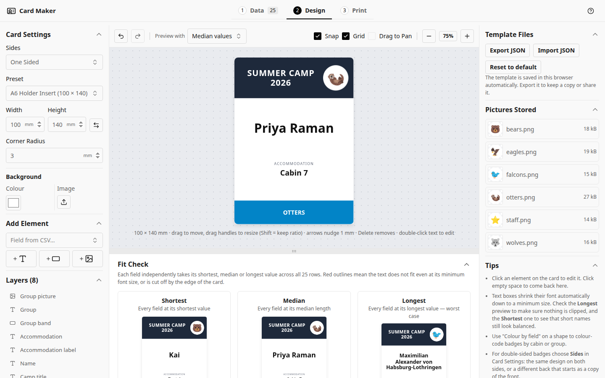
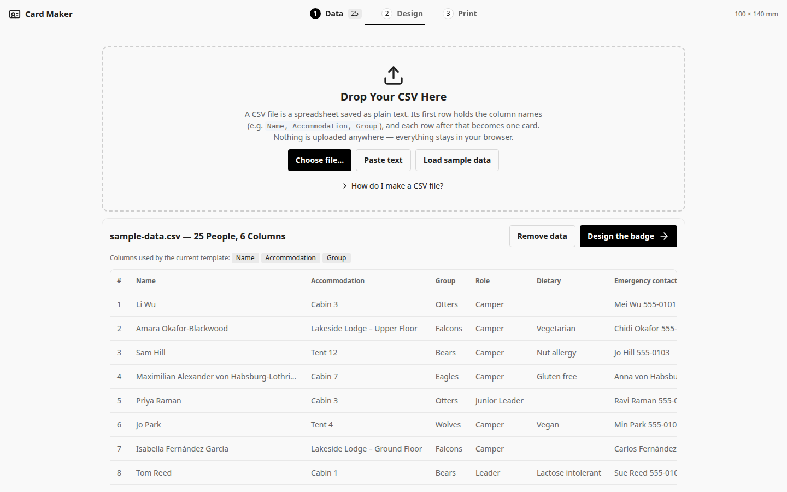
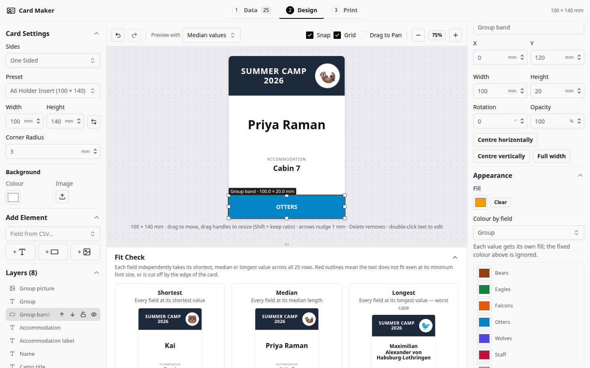
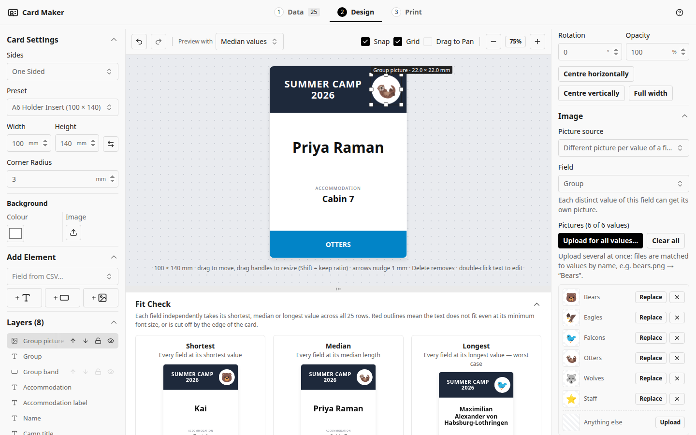
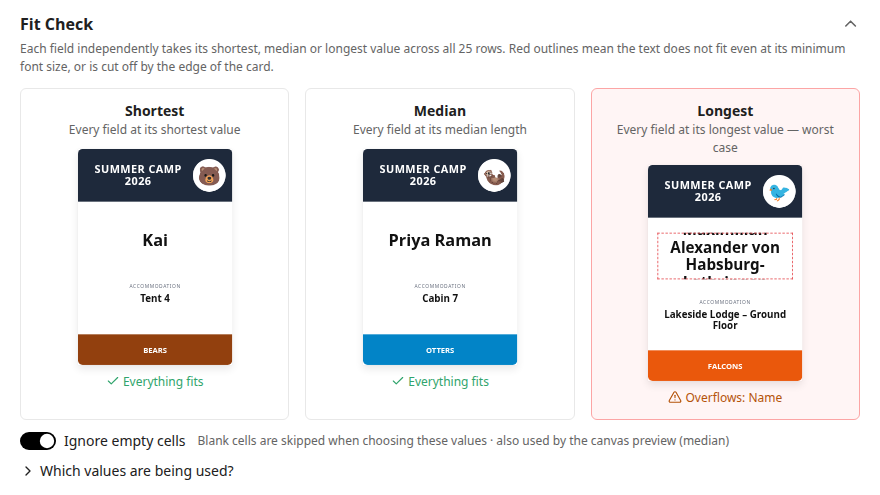
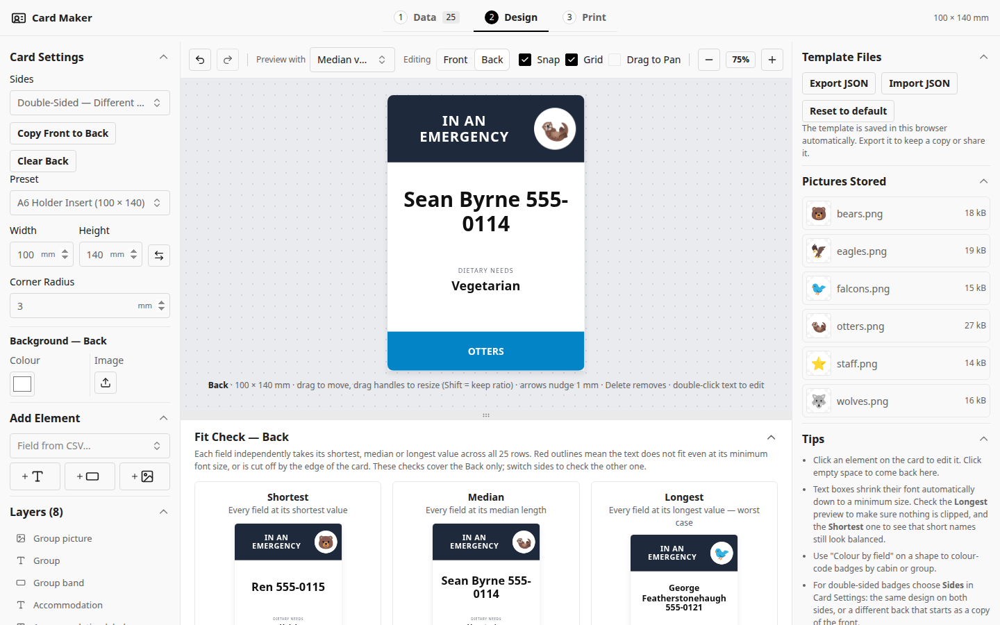
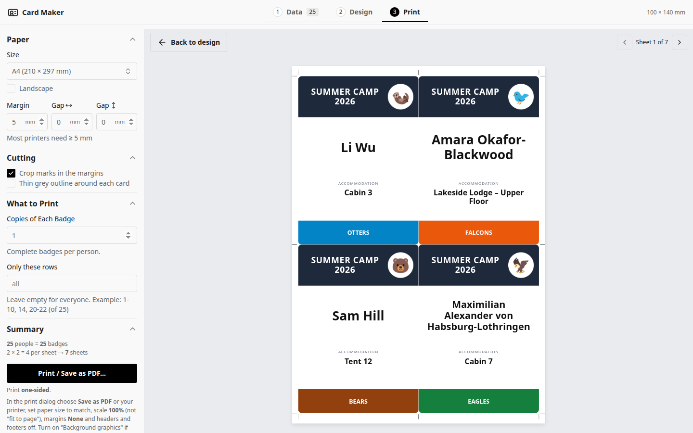
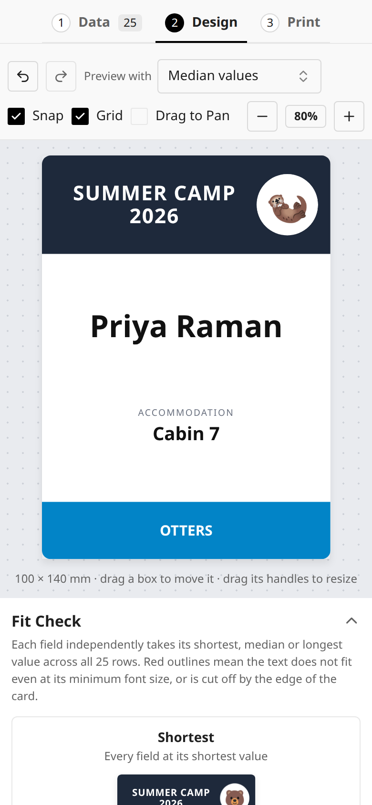

# Card Maker

Card Maker turns a spreadsheet of people into printed name cards. Load a CSV file, design one
card, and print a card for every row — ready to cut out and put into lanyard holders, on desks or
on doors.

**[Open Card Maker](https://rw-a.github.io/lanyard/)** — it runs in your browser; nothing to install.



## When to use it

Card Maker is suited to any event where each person needs a card showing their own details:

- camps, retreats and school trips (name, cabin, group, dietary needs)
- conferences, workshops and volunteer days (name, organisation, role)
- staff and visitor badges, desk and door signs

Use it when the details already live in a spreadsheet and every card follows the same layout.
Because each card is filled in from its row, there is no copying and pasting, and a change to the
design applies to every card at once.

Your data stays on your computer: the CSV, the design and any pictures are kept in your browser
and never uploaded.

## Key features

- **Cards from a spreadsheet** — save your spreadsheet as a CSV file (or copy and paste the cells)
  and place any column on the card.
- **Visual designer** — text, shapes and pictures that you drag, resize and style on a card shown
  at its real proportions, with undo, layers, snapping and keyboard shortcuts.
- **Fit check** — previews built from the shortest, median and longest values in your data show
  straight away if any text is cut off.
- **Colours and pictures per field value** — colour a band or text box, or show a different
  picture, depending on a column, e.g. one colour and an animal per group. Upload all pictures at
  once; they are matched to values by file name.
- **Double-sided cards** — the same design on both sides, or a different front and back.
- **Print-ready sheets** — choose the paper size and margins; cards are laid out with crop marks
  and can be printed or saved as a PDF. Print copies, or just some rows for reprints.
- **Saved automatically** — your work is kept in the browser and can be exported as a file to
  share or back up.
- **Works on phones and tablets** as well as computers.

## Getting started

1. **Data** — choose your CSV file, or paste cells copied from your spreadsheet (see
   [Preparing your data](#preparing-your-data)). To try Card Maker first, choose
   **Load sample data**.
2. **Design** — edit the starter card: click an element to change it, drag it to move it, and add
   text, shapes or pictures. Insert a column into text with `{{Column name}}`.
3. **Print** — choose the paper and settings, check the preview, then choose
   **Print / Save as PDF…**.

## Preparing your data

Card Maker reads a **CSV file**: a spreadsheet saved as plain text, one row per line with the values
separated by commas. Excel, Google Sheets and most other spreadsheet programs can save one.

Set out the spreadsheet with the column names in the first row and one person per row. Each column
becomes a field you can place on the card; each row becomes one card.

| Name         | Accommodation | Group  |
| ------------ | ------------- | ------ |
| Ada Lovelace | Cabin 3       | Otters |
| Sam Hill     | Tent 12       | Bears  |

### Saving a spreadsheet as CSV

- **Excel** — choose _File → Save As_ (or _Save a Copy_), set the file type to _CSV UTF-8 (Comma
  delimited) (.csv)_, and save. Only the sheet that is open is saved. Excel may warn that some
  features will be lost; that is expected.
- **Google Sheets** — choose _File → Download → Comma-separated values (.csv)_. Only the sheet that
  is open is downloaded.
- **Numbers** — choose _File → Export To → CSV_.
- **LibreOffice Calc** — choose _File → Save As_ and set the file type to _Text CSV (.csv)_.

Spreadsheet files such as `.xlsx` cannot be opened directly; save them as CSV first. The Data tab
also explains this under **How do I make a CSV file?**

**No file needed:** select the cells in your spreadsheet, including the column names, copy them,
and choose **Paste text** on the Data tab.



Empty cells are fine. The Data tab shows each column's shortest, median and longest value, which
helps spot entries that may not fit.

## Designing a card

- **Text** can mix fixed words with fields, e.g. `Cabin {{Accommodation}}`. Choose the font,
  size, alignment, colour, background and border. With **Shrink to fit**, long values get a smaller
  font, down to the minimum size you set.
- **Shapes** are filled rectangles, useful for colour bands and frames.
- **Pictures** can be the same on every card, chosen per field value, or taken from a column
  containing image addresses. Large photos are reduced automatically.
- **Card Settings** set the card size (with common presets), corner radius and background colour
  or image.
- **Preview with** shows the card filled in with any row, or with the shortest, median or longest
  values.

| Action                         | Shortcut                              |
| ------------------------------ | ------------------------------------- |
| Undo / redo                    | Ctrl+Z / Ctrl+Shift+Z (⌘ on Mac)      |
| Move the selected element      | Arrow keys (Shift: 5 mm, Alt: 0.1 mm) |
| Duplicate / delete             | Ctrl+D / Delete                       |
| Deselect                       | Esc                                   |
| Keep proportions when resizing | Hold Shift while dragging a corner    |
| Move freely without snapping   | Hold Alt while dragging               |

### Colour per field value

Select a shape or text box and choose a column under **Colour by field**. Each value of that column
gets its own colour, which you can change; **Anything else** covers values without one.



### Picture per field value

Add a picture and set **Picture source** to **Different picture per value of a field**, then choose
the column. Upload a picture for each value, or choose **Upload for all values…** and select all the
files at once: a file named `bears.png` is matched to the value "Bears". An optional fallback
picture is used for any other value.



The same picture used in several places is stored only once. **Pictures Stored** lists each one
with its file name and size.

### Checking that everything fits

The **Fit Check** below the canvas shows three versions of the card: every field at its shortest,
median and longest value in your data. Text that is cut off by its box or by the edge of the card
is outlined in red and named, so it can be fixed before printing. The Fit Check can be collapsed
to give the canvas more room.



### Front and back

Under **Sides** in Card Settings, choose:

- **One Sided** — a front only.
- **Double-Sided — Same on Both Sides** — one design printed on both sides.
- **Double-Sided — Different on Each Side** — a separate back, edited with the **Front / Back**
  switch above the canvas. The back starts as a copy of the front.

Card size is shared by both sides; each side has its own background and elements. Both sides of a
card are filled in from the same row.



## Printing



1. Choose the paper size and orientation, and set the margin and the gaps between cards. The
   summary shows how many cards fit on a sheet and how many sheets are needed.
2. Under **What to Print**, set the number of copies, or list rows to reprint (e.g. `1-10, 14`).
3. Choose **Print / Save as PDF…**. In the print dialog, set the scale to **100%**, margins to
   **None**, and turn on **Background graphics** so colours print. Choose _Save as PDF_ to keep a
   file.

Double-sided cards can be printed in two ways:

- **Separate Cutouts** — each card's front and back are printed side by side on one side of the
  paper. Cut them out and place them back to back in the holder.
- **Duplex Sheets** — fronts are printed on one side of the sheet and backs on the other. Print
  double-sided, flipping on the long edge for portrait paper or the short edge for landscape. Use
  **Print Test Sheet** first to check that the two sides line up on your printer.

The default 100 × 140 mm card fits a standard A6 lanyard holder, four to an A4 sheet.

## Saving and sharing

Your data and design are saved in your browser automatically and are there when you return on the
same computer and browser. To back up a design, move it to another computer or share it, use
**Export JSON** and **Import JSON** under Template Files. If the browser cannot save (for example in
some private windows), a notice says so; export the design to keep it.

## On phones and tablets



All three steps work on small screens. The panels stack, and elements can be moved and resized by
touch.

## Running your own copy

Card Maker is a static web app. To run it locally, install [Node.js](https://nodejs.org/) 22, then:

```bash
npm install
npm run dev
```

Pushing to the `main` branch of a GitHub repository with GitHub Pages enabled (Source: GitHub
Actions) publishes it automatically. Development notes are in [AGENTS.md](AGENTS.md).

## License

[GNU Affero General Public License v3.0](LICENSE).
